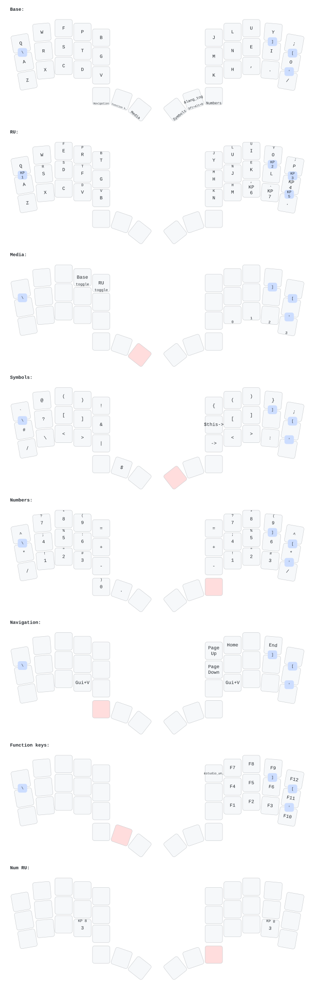

# ZMK config for [Likeeb](https://github.com/HolyErgo/likeeb)

The keymap lives only in `config/likeeb.keymap`: ZMK Studio is off, because bindings saved by Studio override the file.

After sleep or reboot the keyboard starts on the Base (English) layer. `macos/likeeb-english.swift` selects the English input source when the keyboard connects to the Mac. Install:

```sh
swiftc -O -o ~/.local/bin/likeeb-english macos/likeeb-english.swift
cp macos/org.holyergo.likeeb-english.plist ~/Library/LaunchAgents/
launchctl bootstrap gui/$(id -u) ~/Library/LaunchAgents/org.holyergo.likeeb-english.plist
```

The agent presses Ctrl+Space, so it needs Accessibility permission (System Settings → Privacy & Security → Accessibility → likeeb-english); a rebuilt binary needs it again.

Log: `~/Library/Logs/likeeb-english.log`.

You can fork of this repository and customize layout with [Keymap Editor](https://nickcoutsos.github.io/keymap-editor/).



